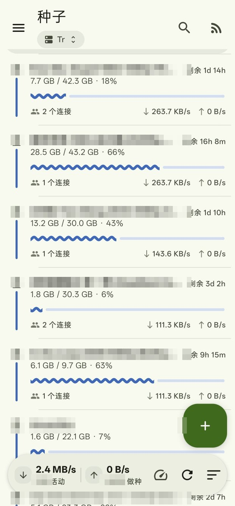
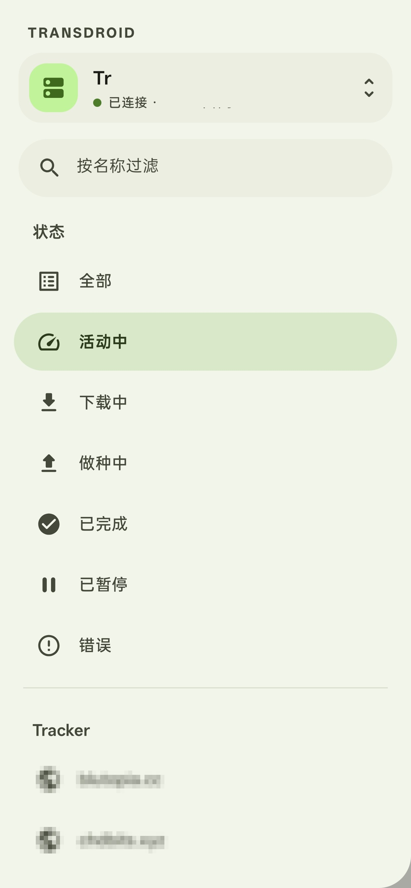
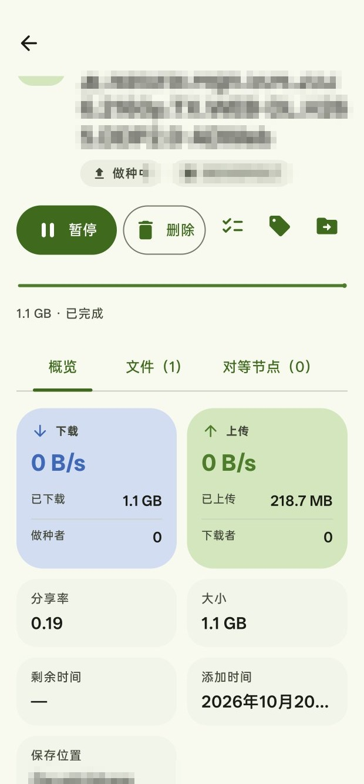
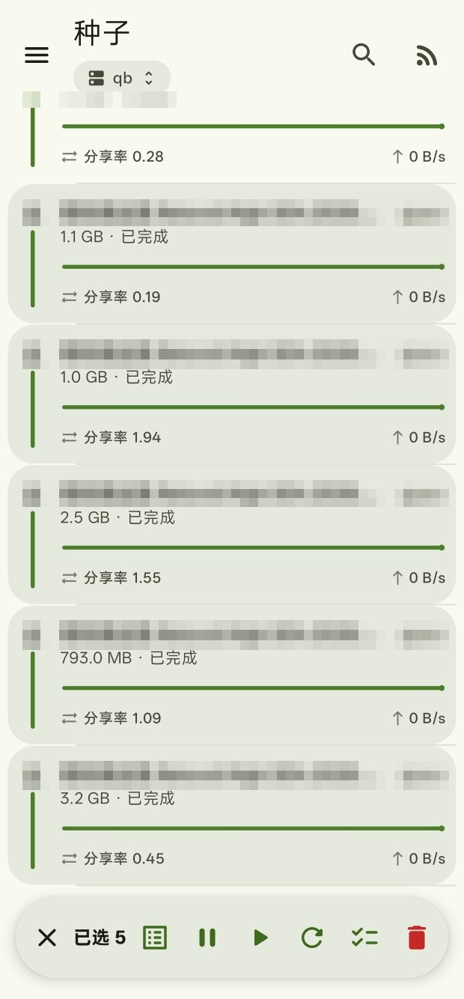

**中文** | [English](README.en.md)

# Transdroid 3.0 中文定制版

**在手机上同时管理 qBittorrent 和 Transmission 的安卓 App，界面全中文。**

---

## 这是什么

一个 BT 下载器的远程控制端。你在 NAS、小主机或服务器上跑 qBittorrent / Transmission，用这个 App 在手机上查看和操作它们，不用开浏览器、不用记端口。

### 能做什么

- **同时管理多台服务器**：NAS 上的 qB + TR、家里的和机房的，都在一个列表里切换，不用装两个 App
- **种子列表**：每个种子显示名称、进度条、下载/上传速度、分享率、大小、标签、保存路径、连接数
- **单种操作**：暂停 / 开始 / 删除（可连数据一起删）/ 校验数据 / 改标签 / 改下载位置
- **批量操作**：长按进入多选，一次暂停、开始、重新汇报、校验或删除一批种子
- **排序**：添加时间、名称、下载速度、上传速度、大小、进度、分享率、完成时间
- **筛选**：按状态（全部 / 活动中 / 下载中 / 做种中 / 已完成 / 已暂停 / 出错）、按标签、按服务器
- **Tracker**：详情页看每个 tracker 的状态与时间，一键全部重新汇报
- **桌面小组件**：把种子列表放到桌面，不用开 App

### 为什么要这个定制版

上游 [Transdroid](https://github.com/erickok/transdroid) 是 GPLv3 开源项目，2.x 稳定但界面老旧；3.0 是 Material 3 + Compose 的全新重写，界面好看但还在 alpha，有三个实际用起来很别扭的地方：

| 问题 | 本版做法 |
|---|---|
| 没有中文，全英文界面 | 补了 362 条简体中文，覆盖全部界面 |
| 只能按 4 个字段排序，做种场景没法按上传速度排 | 加到 8 个字段，含上传速度、大小、进度、完成时间 |
| qBittorrent 的标签永远显示「无标签」 | 修复：上游只读 `category`，没读 `tags` |

再加上多选批量、Tracker 重新汇报、状态筛选「活动中」这几个日常管理最常用的功能。

### 界面长什么样

三块主要界面：

1. **种子列表**（首页）：顶部是搜索和排序按钮，中间是种子卡片，底部是下载/上传总速度统计。左侧滑出抽屉做筛选。
2. **详情页**（点种子进入）：`概览 | 文件 | 对等节点 | Tracker` 四个标签页，底部一排操作按钮。
3. **服务器配置**：支持添加多台服务器，qB 和 TR 分别有自己的配置项。



*种子列表：名称、状态、大小、进度、分享率、上下行速度，底栏是总速度与活动/做种数量*

### 适合谁

- NAS / 家用服务器上跑 qBittorrent 或 Transmission，想在手机上看进度、做种情况
- 需要中文界面
- 不想要国产闭源 App，也不想要订阅制
- 愿意折腾一次配置（填服务器地址、端口、账号）

### 适用客户端

**qBittorrent**、**Transmission**（已测试）。Deluge / rTorrent / Vuze 的适配器保留上游原样，未测试。

- 安装包：见 [Releases](../../releases)
- 当前版本基于上游 `transdroid3` 分支提交 `dfc5e7c`
- 许可：GPLv3（与上游一致）

---

## 一、改了哪些地方

### 1. 简体中文化

`app/src/main/res/values-zh/strings.xml`，362 条字符串，覆盖界面全部文案。上游只带英文，alpha 分支没有本地化。

### 2. 排序字段补全

上游只有「添加时间 / 名称 / 下载速度 / 分享率」四个。现在菜单里是：

| 排序项 | 说明 |
|---|---|
| 添加时间 | 原有 |
| 名称 | 原有 |
| 下载速度 | 原有 |
| **上传速度** | 新增。做种场景最常用 |
| **大小** | 新增 |
| **进度** | 新增 |
| 分享率 | 原有 |
| **完成时间** | 新增。qB 取 `completion_on`，TR 取 `doneDate`；未完成的种子排最后 |

每个字段首次选中时有默认方向（数值类降序、名称升序）。

### 3. qBittorrent 标签修复（重点）

qB 有两个互不相干的字段：

| 字段 | 数量 | 说明 |
|---|---|---|
| `category` | 单个 | 分类，qB 网页里手动维护 |
| `tags` | 多个 | 标签，可以是多个 |

上游只读 `category`，`tags` 根本没进数据模型。所以只要你的种子上打的是 **tags**（绝大多数人的用法），App 就永远显示「无标签」。

本版：

- **读**：`category` 和 `tags` 一起读，多个标签全部列出，左侧抽屉的标签筛选、标签计数一并生效
- **写**：设置标签走 `torrents/addTags`（追加，不动种子上其它标签）；清空走 `torrents/removeTags`（先读出该种子现有 tags 再精确移除）
- **完全不碰 `category`**：上游会把标签写进 category，等于在 qB 里给你造分类出来，本版去掉了这个行为

### 4. 状态筛选「活动中」

判定条件是**当前下载或上传速度大于 0**，也就是真的在传数据。

为什么不用状态判断：qB 的 `stalledUP` 和 TR 的无连接做种都算「做种中」，但速度为 0。按状态筛，几千个种子都会算进来；按速度筛，只有真正在跑的那几十个。



*左侧抽屉：按状态和 Tracker 筛选，计数实时统计（截图中的 Tracker 名称已打码）*

### 5. 重新汇报 Tracker

详情页的 **Tracker 标签页**顶部加了「重新汇报」按钮，向该种子的全部 Tracker 立即汇报一次。

- qB：`api/v2/torrents/reannounce`
- TR：`torrent-reannounce`

**没有做单个 tracker 的独立汇报**，因为两个客户端的接口都是**种子级**的：点任何一个 tracker 的汇报按钮，实际都会汇报全部。做成单行按钮只会误导。



*详情页：概览卡片显示分享率、大小、时间与保存位置；文件、对等节点、Tracker 分标签页（截图中的文件名与站点名已打码）*

### 6. 多选与批量操作

**长按**任意种子进入选择模式：

- 点击行 = 勾选 / 取消
- 底部速度统计栏换成操作条：`✕ │ 已选 N 项 │ 全选 ⏸ ▶ ⟳ ✓ 🗑`
- 依次是：全选、暂停、开始、重新汇报、校验数据、删除（红色）
- 删除会弹确认框，仍可勾「同时删除已下载的数据」
- 选择模式下，滑动手势（右滑暂停 / 左滑删除）停用，避免和点击冲突
- 点 ✕ 或操作完成后自动退出

**「全选」只选当前筛选结果**，抽屉里被过滤掉的种子不会被选中。

批量请求是**并发**发出的：qB/TR 的接口一次只接受一个种子，串行处理 100 个要好几分钟。个别失败不影响其余，结束后统一报错。



*长按进入多选，底部操作条依次是：全选、暂停、开始、重新汇报、校验数据、删除（截图中的种子名已打码）*

### 7. 底栏布局修复

360dp 宽的手机上，右侧排序按钮会被速度统计文字挤出屏幕（TR 的「4962 个做种中」尤其明显）。

- 统计区改为占用剩余宽度 + 省略号
- 图标按钮 48 → 40dp、间距 10 → 6dp
- 中文文案缩短：「4962 个做种中」→「4962 做种」

### 8. 详情页按钮宽度修复

详情页那排按钮里，绿色主按钮是唯一用剩余空间的元素，其余固定宽度。算下来它只剩 54dp，只够一个图标，「开始 / 暂停」两个字被裁掉，看起来像图标不变化。

本版收紧各项内边距与图标按钮尺寸，腾出约 92dp，绿色按钮可用宽度提到约 106dp，文字完整显示。

---

## 二、几个容易误解的地方（使用说明）

### 绿色按钮里的图标是「动作」，不是「状态」

| 当前状态 | 按钮显示 | 含义 |
|---|---|---|
| 做种中 / 下载中 | ⏸ 暂停 | 点它会暂停 |
| 已暂停 | ▶ 开始 | 点它会继续 |

点了之后要等约 2 秒（自动刷新）图标才切换。如果看到图标一直不变，先确认种子状态标签是否已经变了。

### 详情页底部那几个图标是什么

从左到右：

| 图标 | 功能 |
|---|---|
| ⏸ / ▶ 绿色按钮 | 暂停 / 开始该种子 |
| 🗑 删除 | 从服务器移除，弹窗可勾「同时删除已下载的数据」 |
| ☑ 双勾清单 | **校验数据**（重新逐块校验本地文件完整性），不是多选 |
| 🏷 标签 | 设置标签，有标签时高亮 |
| 📁→ 文件夹带箭头 | 设置下载位置（qB/TR 会真的移动文件） |

### 「活动中」和「做种中」的区别

- 做种中：状态是 seeding，包括没有任何连接的空转做种
- 活动中：当前有实际传输速度

用「活动中」看真正在跑的种子；用「做种中」看保种数量。

### qB 里打标签的正确方式

在 qB 网页里给种子加的是 **tags**（标签），不是 category（分类）。本版读的是 tags，所以你在 qB 里打的标签会出现在 App 里。

在 App 里给种子设标签，写的是 tags（追加），不会影响你在 qB 里已有的 category。

---

## 三、安装

**签名与上游版本、与本仓库历史版本的关系：**

| 从哪装 | 能否覆盖安装 |
|---|---|
| 上游 alpha6 或官方版本 | ❌ 签名不同，必须先卸载（设置会丢） |
| 本仓库的其它 Release | ✅ 同一把签名，直接覆盖，配置保留 |

首次从上游切换过来时，如果不想丢服务器配置：先在旧版里导出设置，卸载，装本版，再导入。

---

## 四、已知限制

- 只测过 qBittorrent 4.5.x 和 Transmission 4.0.x；Deluge / rTorrent / Vuze 的适配器保留上游原样
- 标签改写采用「追加」策略，因为界面是单选。「清空标签」会移除该种子的全部 tags
- 单个 tracker 无法单独汇报（客户端接口是种子级的）
- widget 的排序支持新增字段，但显示内容沿用上游设计
- 不追上游新提交；要合并上游改动需要手工解决冲突

---

## 五、自己编译

需要 JDK 17 + Android SDK（platform 36 / build-tools 36）+ Gradle 9.5。

```bash
# local.properties
echo "sdk.dir=/你的/Android/Sdk" > local.properties

./gradlew assembleFullRelease
# 产物：app/build/outputs/apk/full/release/app-full-release.apk
```

发布包需要在 `keystore.properties` 里配签名（本仓库不含密钥）。

---

## 致谢

上游 [Transdroid](https://github.com/erickok/transdroid) 由 Eric Kok 等人以 GPLv3 发布。本仓库只是在其 alpha 分支上做本地化与功能补充。
